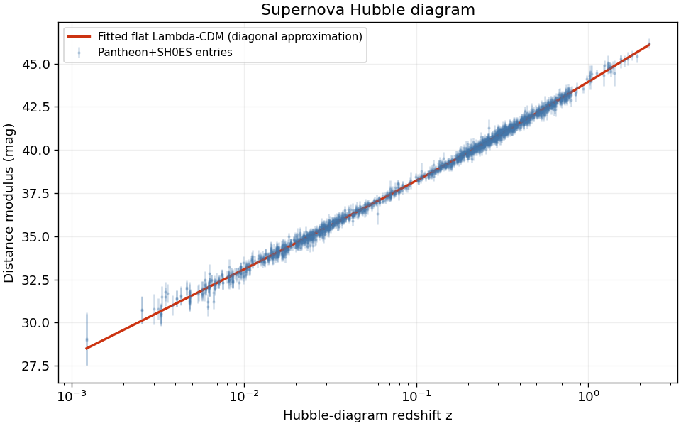

# Supernova cosmology: summer-school project

**Ansh Shinde** | Python, observational cosmology, numerical integration and model fitting

A summer-school analysis of Pantheon+SH0ES Type Ia supernovae, covering flat Lambda-CDM model fitting, Hubble diagrams, residual analysis, and estimates of the age of the Universe.

## Scientific scope

This is an **educational diagonal-error approximation**, conditional on the existing SH0ES calibration. The data authors require full covariance for cosmological inference. The errors below are conditional fit errors and are **not full cosmological uncertainties**. This project does not independently measure the Hubble tension or establish evolving dark energy.

| Fit | H0 (km/s/Mpc) | Omega_m |
|---|---:|---:|
| Both parameters free | 72.974 +/- 0.262 | 0.3508 +/- 0.0187 |
| Fixed matter density, all entries | 73.530 +/- 0.172 | 0.3 fixed |
| Fixed matter density, z < 0.1 | 73.007 +/- 0.277 | 0.3 fixed |
| Fixed matter density, z >= 0.1 | 73.848 +/- 0.218 | 0.3 fixed |

The derived age at the fitted parameters is 12.358 Gyr. At H0=72.97 and Omega_m=0.3 it is 12.919 Gyr. See the notebook for assumptions and diagnostics.



## Run

Use Python 3.12 or newer with the tested package versions in `requirements.txt`.

```bash
python -m pip install -r requirements.txt
python supernova_cosmology.py
```

Alternatively open `supernova_cosmology.ipynb` in Jupyter or Colab and run all cells. JupyterLab or the Notebook interface can be installed separately; ipykernel is included here. On a headless machine use `MPLBACKEND=Agg python supernova_cosmology.py`.

Internet is needed for the initial download of the official data. The checksum is verified. The raw dataset is not bundled; subsequent runs use `data/Pantheon+SH0ES.dat`. Execute from this project's directory. Figures and `results.json` are regenerated.

## Numerical checks

- Distance moduli checked against Astropy.
- Ages checked against the analytic matter-plus-Lambda solution.
- Fixed-density fits checked against an exact weighted-intercept solution.
- All seven code cells executed successfully, with outputs included in the notebook.

These checks validate the implementation of the chosen approximation, not a precision cosmological likelihood.

## Sources

- [Official data and covariance documentation](https://github.com/PantheonPlusSH0ES/DataRelease/tree/main/Pantheon%2B_Data/4_DISTANCES_AND_COVAR)
- [Brout et al. 2022: Cosmological Constraints](https://arxiv.org/abs/2202.04077)
- [Riess et al. 2022: SH0ES](https://arxiv.org/abs/2112.04510)
- [Planck 2018 cosmological parameters](https://arxiv.org/abs/1807.06209)

The Pantheon+SH0ES data remain subject to their authors' terms.

